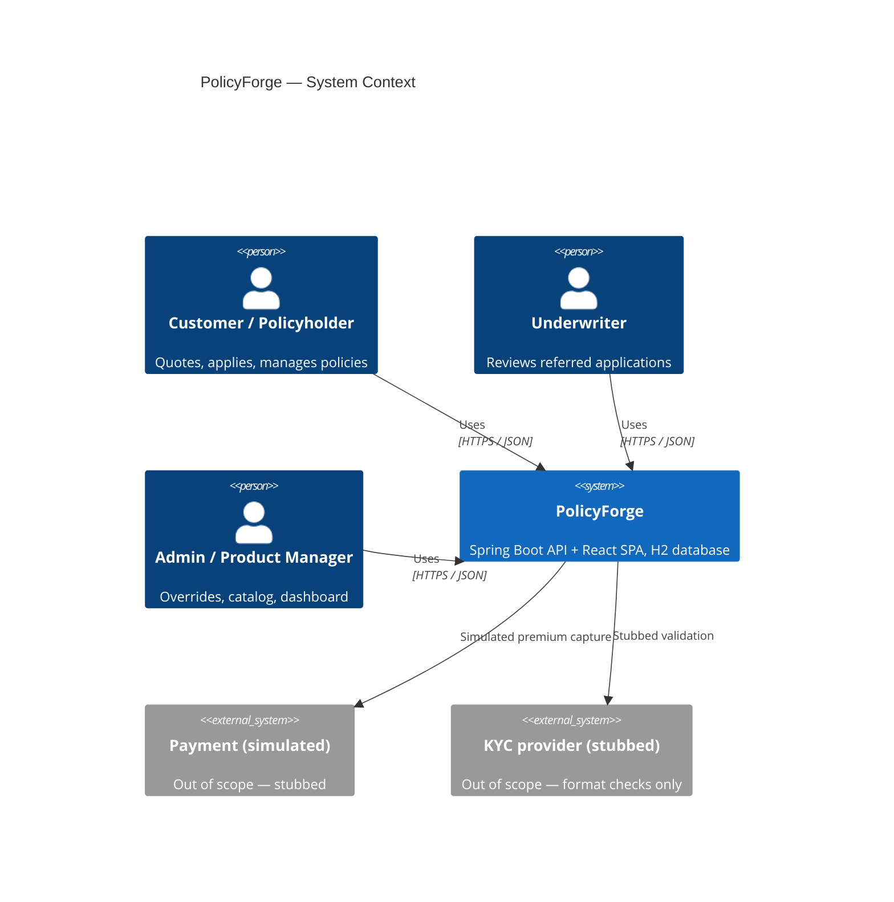
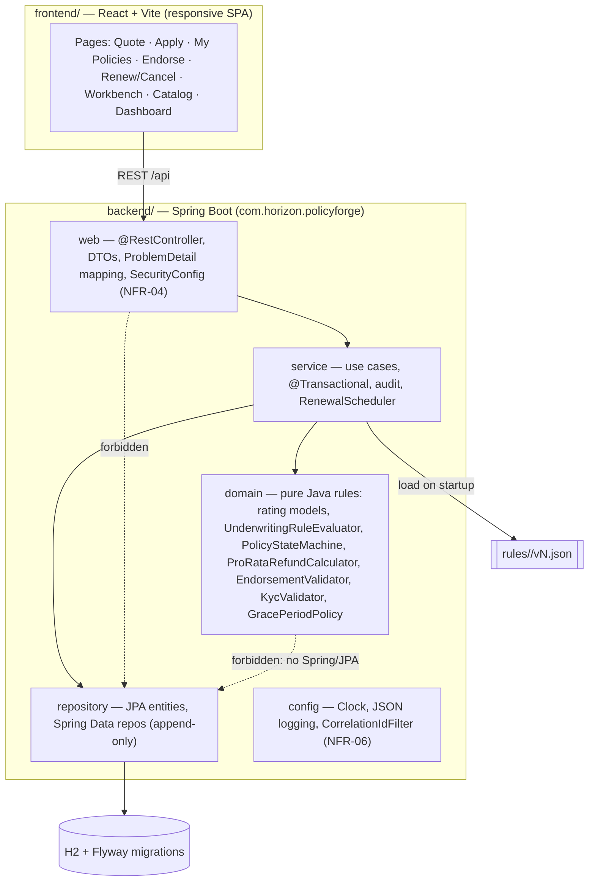
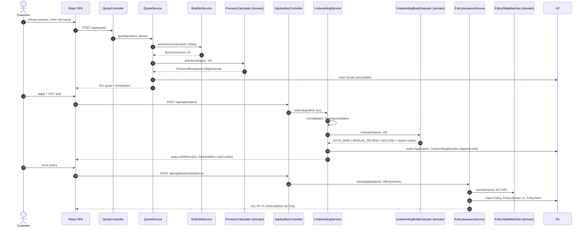
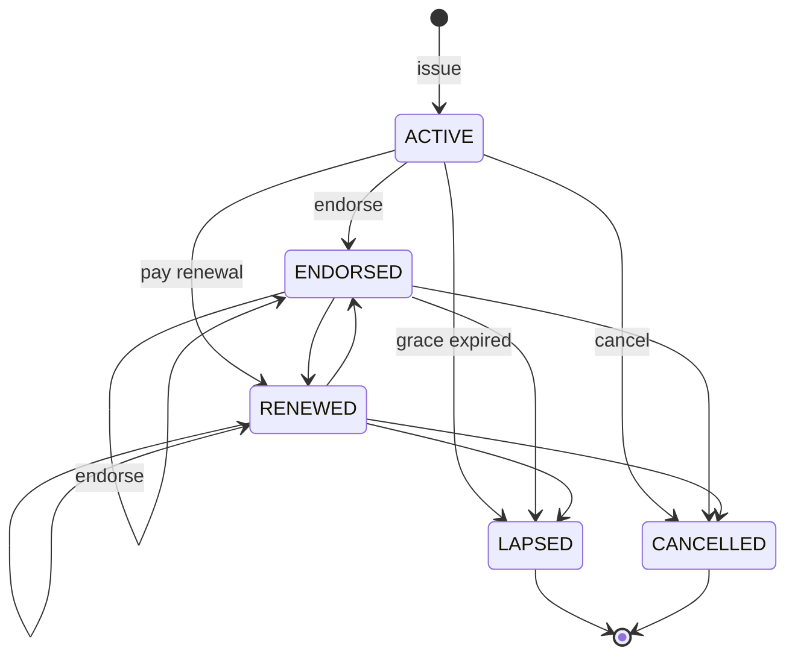

# PolicyForge — Architecture

## 1. System context (C4 level 1)

## 2. Layered structure

| Layer | Package | May depend on | Must not depend on |
|---|---|---|---|
| web | `..web..` | service, domain (value types) | repository |
| service | `..service..` | repository, domain | web |
| repository | `..repository..` | domain (value types) | web, service |
| domain | `..domain..` | JDK only (`java.*`) | Spring, Jakarta, web, service, repository |
| config | `..config..` | anything | (not depended on by domain) |

ArchUnit enforces these rules (`backend/src/test/java/com/horizon/policyforge/architecture/`):
- `LayeredArchitectureTest`: the layer matrix above.
- `DomainPurityArchTest`: the domain has no `org.springframework..`, `jakarta.persistence..` or web imports.
- `MoneyPrecisionArchTest`: no `double`/`float`/`Double`/`Float` fields, parameters or returns in `domain` or
  `service` money classes (NFR-01).
- `AppendOnlyArchTest`: append-only entities (`PolicyVersionEntity`, `EndorsementEntity`,
  `PolicyStatusTransitionEntity`, `RefundRecordEntity`, `AuditEntryEntity`, `RuleSetVersionEntity`,
  `UnderwritingDecisionEntity`) have no public setters, and their repositories don't declare `delete*` methods
  (NFR-02).
- `ControllerPlacementArchTest`: `@RestController` classes live only in `..web..`, and their names end in
  `Controller`.

## 3. Quote-to-bind sequence

## 4. Policy state machine

## 5. Cross-cutting concerns

| Concern | Mechanism |
|---|---|
| Money (NFR-01) | `BigDecimal`. `Money` helper in domain: scale 10 intermediate, scale 2 HALF_UP final |
| Append-only (NFR-02/05) | Immutable JPA entities (no setters, `@Immutable` where applicable), no delete repo methods, Flyway with `validateOnMigrate` |
| PII (NFR-03) | PII fields are never passed to loggers. `PiiMasker` for API responses. Logback JSON encoder with no request-body logging. Hook-enforced |
| Auth (NFR-04) | Spring Security HTTP Basic, in-memory synthetic users, `@PreAuthorize` on controllers. `AuditService` writes the actor ID |
| Logging (NFR-06) | `logstash-logback-encoder` JSON. `CorrelationIdFilter` puts `correlationId` in MDC and echoes the header |
| Health (NFR-07) | Spring Boot Actuator `/actuator/health` |
| Time | Injected `Clock` bean. Tests use `Clock.fixed` |
| Rule versions | JSON files loaded into `rule_set_version` on startup if absent. Published through the API afterwards |

## 6. Deployment (local)

A single command, `cd backend && ./mvnw spring-boot:run`. `frontend-maven-plugin` builds the React app into
`backend/target/classes/static`, so one process on port 8080 serves both the SPA and `/api`. For dev, the frontend can
run on Vite (`npm run dev`, port 5173), proxying `/api` to 8080.
